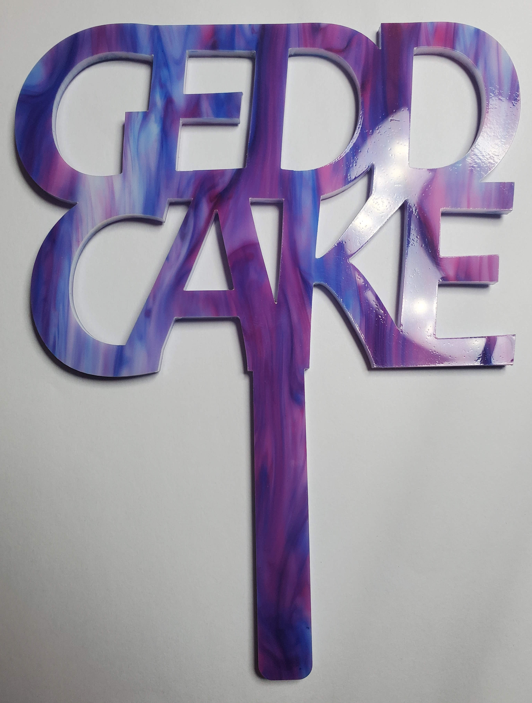

# GeddCake

A cake topper for Geddes' birthday.

Photo of one of the cake toppers cut from [Ponoko](https://www.ponoko.com/)'s [Purple Swirl Acrylic](https://www.ponoko.com/materials/purple-swirl-acrylic).

## How big should I make this?

Geddes is obsessed with ChatGPT right now, so let's ask it:

* The average cake diameter that serves 8-10 people is approximately 200-230 mm.
* A "happy birthday" sign for a cake with a diameter of 200-230mm should ideally have a width of no more than 133-153mm.
* The average height of a cake for 8-10 people can vary depending on the recipe and design, but a typical height would be around 50-75mm

## Food safety

TODO: ...................................
